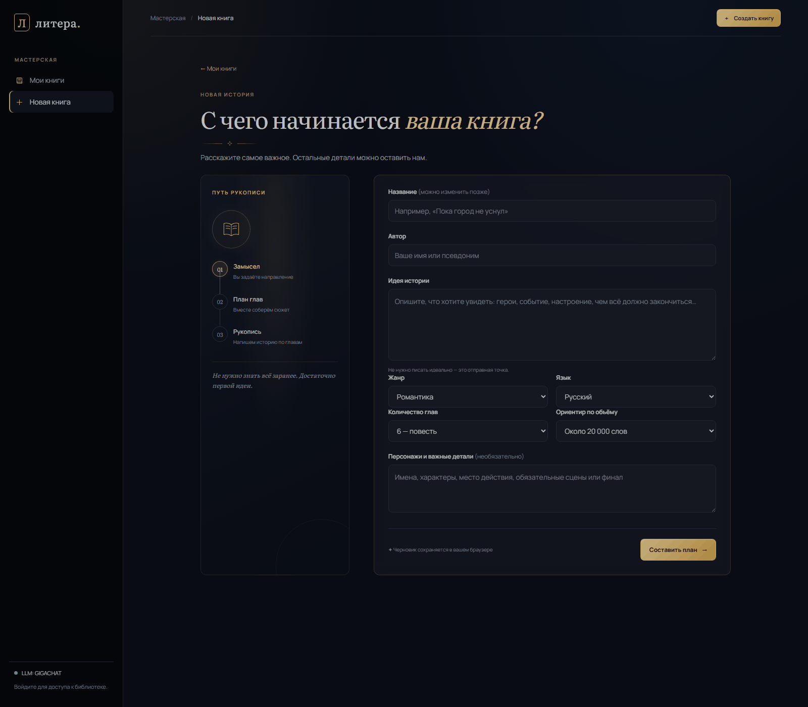

# Litera / Литера

**RU:** Веб-мастерская: идея → план глав → рукопись → серверный PDF с обложкой.
**EN:** A book creation web app: idea → chapter plan → manuscript → server-rendered PDF cover and layout.



## Возможности / Features

- GigaChat или OpenRouter через общий OpenAI-совместимый интерфейс
- Supabase Auth, RLS и личная библиотека книг
- Шаблоны обложек для каждого жанра
- Серверный A4 PDF с оглавлением и локальным шрифтом
- Русский и английский интерфейс генерации

## English

Litera turns an idea into an edited chapter plan and a downloadable A4 PDF. It uses GigaChat or OpenRouter behind one provider interface, stores books in Supabase, and creates cover art locally by genre.

1. Copy `.env.example` to `.env`.
2. Set `GIGACHAT_API_KEY` and, for cloud storage, `SUPABASE_URL` and `SUPABASE_ANON_KEY`.
3. Run `python server.py` and open `http://127.0.0.1:8000`.
4. Apply `supabase.sql` in the Supabase SQL Editor.
5. Enable Email/Password authentication and email confirmation for a public deployment.

Deploying is free only for a demo tier. Render Free sleeps after inactivity, while Supabase Free has database, bandwidth and project-lifetime limits. Never commit `.env`, API keys or `service_role` credentials.

## Быстрый старт / Quick start

1. Создайте проект и ключ GigaChat API в кабинете разработчика Сбера. Нужен **ключ авторизации** API (Basic key), а не краткоживущий access token.
2. Скопируйте `.env.example` в `.env`:

   ```powershell
   Copy-Item .env.example .env
   ```

3. Откройте `.env` и задайте `GIGACHAT_API_KEY`. По умолчанию выбран `LLM_PROVIDER=GIGACHAT`, scope `GIGACHAT_API_PERS` и модель `GigaChat-3-Ultra`. При смене провайдера перезапустите сервер.
4. Установите зависимости и запустите приложение:

   ```powershell
   .\.venv\Scripts\python.exe -m pip install -r requirements.txt
   .\.venv\Scripts\python.exe server.py
   ```

5. Откройте [http://127.0.0.1:8000](http://127.0.0.1:8000).

Ключи API остаются на сервере и не выдаются странице. Файл `.env` исключён из Git.

### Сертификат GigaChat в Windows

Если при подключении появляется `CERTIFICATE_VERIFY_FAILED` или сообщение о self-signed certificate, GigaChat требует корневой сертификат Минцифры. Скачайте сертификат с официальной страницы Госуслуг `https://www.gosuslugi.ru/crt` и укажите путь к PEM-файлу (или bundle с корневым и выпускающим сертификатами) в `.env`:

```env
GIGACHAT_CA_BUNDLE=C:\путь\к\сертификату.pem
```

Это включает проверку TLS-сертификата GigaChat через указанный bundle; не отключайте проверку сертификатов. Перезапустите сервер после изменения `.env`.

### Переключение LLM-провайдера

Для GigaChat:

```env
LLM_PROVIDER=GIGACHAT
GIGACHAT_API_KEY=ваш_ключ_авторизации_из_кабинета
GIGACHAT_SCOPE=GIGACHAT_API_PERS
GIGACHAT_MODEL=GigaChat-3-Ultra
```

Для OpenRouter задайте `LLM_PROVIDER=OPENROUTER`, `OPENROUTER_API_KEY` и `OPENROUTER_MODEL` — точный ID модели из каталога OpenRouter. Сервис использует общий клиент `openai` с разными `base_url` и авторизацией провайдера. Квоты, доступность моделей и условия бесплатного тарифа определяет сам провайдер.

## Supabase: аккаунт и постоянная библиотека

1. Создайте бесплатный проект Supabase.
2. В **SQL Editor** выполните содержимое `supabase.sql`. Таблица хранит книгу как JSONB; SQL также выдаёт роли `authenticated` права на операции с таблицей, а RLS-политики разрешают пользователю читать и изменять только его строки.
3. В настройках Auth включите Email/Password. Для личного теста можно отключить подтверждение email; для публичного сайта настройте подтверждение и URL редиректа.
4. Возьмите **Project URL** и **publishable/anon key**. Не используйте `service_role` key.
5. Заполните `SUPABASE_URL` и `SUPABASE_ANON_KEY` в `.env`. Перезапустите сервер, затем зарегистрируйтесь через экран входа.

Когда Supabase сконфигурирован, нужен вход в аккаунт. Книги сохраняются в таблице Supabase; браузерный `localStorage` используется только как локальный кеш. Бэкенд проверяет Supabase-сессию перед генерацией и экспортом PDF.

Если библиотека показывает ошибку доступа к `books`, повторно выполните `supabase.sql` в SQL Editor, чтобы применить права таблицы и RLS-политики.

## Серверный PDF

Кнопка **Скачать PDF** обращается к Python-серверу. Серверный ReportLab создаёт титульную страницу с названием и автором, оглавление с номерами страниц, отдельную страницу для каждой главы и колонтитулы. В репозитории лежит локальный Noto Serif с лицензией SIL Open Font License. Формат A4, поля 28/22/23/25 мм. Это читабельный PDF для экрана и домашней печати, не готовый типографский preflight.

## Публикация в интернете на Render Free

В репозитории есть `render.yaml` для развёртывания Python web service.

1. Загрузите проект в свой GitHub-репозиторий. Не добавляйте `.env` или ключи в коммит.
2. Создайте проект Supabase и выполните шаги раздела выше.
3. В Render выберите **New → Blueprint**, подключите репозиторий и подтвердите создание сервиса.
4. В настройках Render добавьте секретные Environment Variables: `GIGACHAT_API_KEY`, `SUPABASE_URL`, `SUPABASE_ANON_KEY`. Остальные значения GigaChat уже заданы в `render.yaml`. Для OpenRouter вместо GigaChat задайте `LLM_PROVIDER=OPENROUTER`, `OPENROUTER_API_KEY`, `OPENROUTER_MODEL`.
5. После деплоя откройте выданный Render URL. Добавьте URL сайта в разрешённые URL и Redirect URLs в настройках Supabase Auth.

Render Free засыпает при простое, поэтому первый запрос после паузы может ждать запуска сервиса. Бесплатный тариф и доступность Render из России не гарантируются; если он недоступен из вашей сети, потребуется другой хостинг. Supabase Free тоже имеет лимиты и может приостанавливать неактивные проекты. Для нескольких пользователей защита от превышения расходов, лимиты генерации и резервное копирование потребуют отдельной настройки.

## Ограничения

- Это персональный MVP, не коммерческий multi-tenant продукт с очередями и гарантиями доступности.
- Ключи GigaChat/OpenRouter действуют от имени владельца сервера. Если сайт публичный, оставьте Supabase Auth включённым; не убирайте проверку сессии из API.
- Генерация длинного романа состоит из отдельных запросов и зависит от контекста и лимитов выбранной модели.
- Бесплатные условия провайдеров и хостинга меняются. Проверяйте текущие тарифы перед публикацией.
